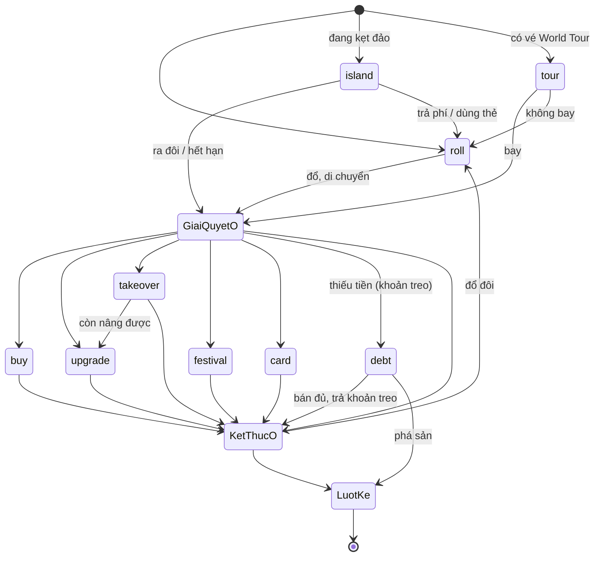

# Luật chơi Thái Thịnh Monopoly — v1.6.0

> Tự sinh từ `public/rules.js` bằng `npm run rules:doc`. Không sửa tay file này: sửa `rules.js`, chạy `npm run verify`.

Bộ luật có ba lớp: **thông số** (con số), **sơ đồ trạng thái** (luồng một lượt), **bảng quyết định** (kết quả từng tình huống). Engine đọc thông số và sơ đồ trạng thái từ cùng file; mỗi dòng bảng quyết định là một bài kiểm thử (`test/rules.test.js`).

## 1. Thông số

| Thông số | Giá trị |
|---|---|
| Tiền đầu ván | 2000K |
| Lương qua Start | 300K |
| Số người chơi | 2–4 |
| Đổ đôi liên tiếp vào đảo | lần thứ 3 |
| Lost Island | kẹt 3 lượt, phí rời đảo 200K |
| Lễ hội (Championships) | ×2 → ×3 → ×4 → ×5 theo số lần tổ chức |
| Vé World Tour | 50K |
| Thuế | 10% tổng tài sản, tối thiểu 50K |
| Giá trị cộng dồn theo cấp | Ô đất ×1, Nhà 1 ×1.5, Nhà 2 ×2.5, Nhà 3 ×4, Khách sạn ×6 (× giá đất) |
| Tiền thuê theo cấp | Ô đất ×0.25, Nhà 1 ×0.6, Nhà 2 ×1.5, Nhà 3 ×3.2, Khách sạn ×5.5 (× giá đất) |
| Giới hạn xây | vòng đầu tối đa Nhà 2; đã qua Start: Nhà 3; Khách sạn khi quay lại ô đã có Nhà 3 |
| Mua lại | 2× giá trị cộng dồn; Khách sạn và bãi biển không bị mua lại; người mua nhận nguyên cấp nhà |
| Bán cho ngân hàng | 50% giá trị cộng dồn |
| Độc quyền nhóm màu | thuê ×2 |
| Bãi biển | giá 200K; thuê 50K / 100K / 200K / 400K theo số bãi cùng chủ |
| Cờ lễ hội | mỗi ván 3 ô ngẫu nhiên, thuê ×1.5 |
| Làm tròn tiền thuê | 0.5K |
| Thẻ Cúp điện | 3 vòng |
| Thời lượng ván | 60 phút / 90 phút / 120 phút; hết giờ → giàu nhất thắng |
| Thời gian mỗi bước | 20 / 30 / 45 / 60 giây (mặc định 30), cộng 6 giây cho hoạt ảnh; hết giờ → tự đi |
| Mất kết nối | người khác bấm "Đi hộ" sau 15 giây; server tự đi sau 60 giây |

### Bàn cờ

| Ô | Tên | Loại | Nhóm | Giá đất | Thuê Ô đất → Khách sạn |
|---|---|---|---|---|---|
| 0 | Start | start |  |  |  |
| 1 | Granada | city | Tây Ban Nha | 50K | 12.5 / 30 / 75 / 160 / 275 |
| 2 | Seville | city | Tây Ban Nha | 60K | 15 / 36 / 90 / 192 / 330 |
| 3 | Madrid | city | Tây Ban Nha | 70K | 17.5 / 42 / 105 / 224 / 385 |
| 4 | Bali | resort |  | 200K |  |
| 5 | Hong Kong | city | Trung Quốc | 80K | 20 / 48 / 120 / 256 / 440 |
| 6 | Beijing | city | Trung Quốc | 90K | 22.5 / 54 / 135 / 288 / 495 |
| 7 | Shanghai | city | Trung Quốc | 100K | 25 / 60 / 150 / 320 / 550 |
| 8 | Lost Island | island |  |  |  |
| 9 | Venice | city | Ý | 120K | 30 / 72 / 180 / 384 / 660 |
| 10 | Milan | city | Ý | 130K | 32.5 / 78 / 195 / 416 / 715 |
| 11 | Rome | city | Ý | 140K | 35 / 84 / 210 / 448 / 770 |
| 12 | Chance | chance |  |  |  |
| 13 | Hamburg | city | Đức | 160K | 40 / 96 / 240 / 512 / 880 |
| 14 | Cyprus | resort |  | 200K |  |
| 15 | Berlin | city | Đức | 180K | 45 / 108 / 270 / 576 / 990 |
| 16 | Championships | festival |  |  |  |
| 17 | London | city | Anh – Úc | 200K | 50 / 120 / 300 / 640 / 1100 |
| 18 | Dubai | resort |  | 200K |  |
| 19 | Sydney | city | Anh – Úc | 220K | 55 / 132 / 330 / 704 / 1210 |
| 20 | Chance | chance |  |  |  |
| 21 | Chicago | city | Mỹ | 240K | 60 / 144 / 360 / 768 / 1320 |
| 22 | Las Vegas | city | Mỹ | 260K | 65 / 156 / 390 / 832 / 1430 |
| 23 | New York | city | Mỹ | 280K | 70 / 168 / 420 / 896 / 1540 |
| 24 | World Tour | tour |  |  |  |
| 25 | Nice | resort |  | 200K |  |
| 26 | Lyon | city | Pháp | 300K | 75 / 180 / 450 / 960 / 1650 |
| 27 | Paris | city | Pháp | 320K | 80 / 192 / 480 / 1024 / 1760 |
| 28 | Chance | chance |  |  |  |
| 29 | Osaka | city | Nhật Bản | 350K | 87.5 / 210 / 525 / 1120 / 1925 |
| 30 | Tax | tax |  |  |  |
| 31 | Tokyo | city | Nhật Bản | 400K | 100 / 240 / 600 / 1280 / 2200 |

### Thẻ Chance

| Thẻ | Trọng số | Tác dụng |
|---|---|---|
| Cúp điện | 15 | Chọn 1 thành phố của đối thủ: mất điện 3 vòng, không thu được tiền thuê và mất lễ hội. |
| Động đất | 10 | Chọn 1 thành phố của đối thủ (đã có nhà, chưa lên Khách sạn) để hạ 1 cấp. |
| Đổi đất cưỡng chế | 8 | Đổi 1 thành phố của bạn lấy 1 thành phố của đối thủ (đều chưa lên Khách sạn). |
| Thẻ VIP | 12 | Giữ trong tay: tự động miễn 100% tiền thuê một lần. |
| Thoát đảo | 12 | Giữ trong tay: rời Lost Island ngay, không mất phí. |
| Tổ chức lễ hội | 13 | Đi ngay tới Championships để tổ chức lễ hội. |
| Vé máy bay | 12 | Đi ngay tới World Tour, lượt sau bay tới ô bất kỳ. |
| Trúng số độc đắc | 18 | Nhận ngay 200K từ ngân hàng. |

## 2. Sơ đồ trạng thái

| Bước | Khi nào | Hành động hợp lệ → kết quả |
|---|---|---|
| `roll` | Chờ đổ xúc xắc | **roll**: Đổ 2 xúc xắc, đi tổng số ô → giải quyết ô dừng. Đổ đôi: được đổ thêm sau khi xong ô (đôi lần 3 → Lost Island). |
| `island` | Đang kẹt ở Lost Island | **roll**: Ra đôi → thoát và đi luôn; không ra đôi → mất 1 lượt (hết 3 lượt thì tự rời đảo và đi). **payIsland**: Trả phí rời đảo → về bước roll. **useCard**: Dùng thẻ Thoát đảo → về bước roll. |
| `tour` | Lượt sau khi dừng ở World Tour | **tour**: Trả vé, bay tới ô đã chọn (qua Start vẫn nhận lương) → giải quyết ô dừng. **skip**: Không bay → về bước roll. |
| `buy` | Dừng ở ô chưa có chủ, đủ tiền mua đất | **buy**: Mua đất + xây tới cấp chọn (≤ giới hạn vòng) → kiểm tra thắng → kết thúc ô. **skip**: Không mua → kết thúc ô. |
| `upgrade` | Dừng ở ô của mình (hoặc vừa mua lại) còn nâng cấp được | **upgrade**: Nâng lên cấp chọn → kết thúc ô. **skip**: Để sau → kết thúc ô. |
| `takeover` | Vừa trả thuê ô người khác, đủ tiền mua lại | **takeover**: Trả 2× giá trị cho chủ, nhận nguyên cấp nhà → nếu còn nâng cấp được thì sang upgrade, không thì kết thúc ô. **skip**: Không mua → kết thúc ô. |
| `festival` | Dừng ở Championships, có ít nhất 1 ô | **festival**: Tổ chức lễ hội ở ô chọn, hệ số tăng 1 bậc → kết thúc ô. **skip**: Bỏ qua → kết thúc ô. |
| `card` | Thẻ Chance cần chọn ô | **card**: Áp dụng thẻ lên ô chọn (Đổi đất: chọn 2 lần) → kết thúc ô. **skip**: Bỏ thẻ → kết thúc ô. |
| `debt` | Có khoản phải trả (thuê/thuế) lớn hơn tiền mặt; khoản này đang treo | **sell**: Bán 1 ô cho ngân hàng; đủ tiền thì trả khoản treo cho người nhận → kết thúc ô (đổ đôi thì đổ tiếp). **bankrupt**: Phá sản: toàn bộ tiền mặt cho người nhận, đất trả về ngân hàng → lượt người kế. |

- Phòng chờ: người vào đầu tiên là host; chỉ host được đổi cấu hình room, mời người chơi ra, bắt đầu hoặc reset ván. Host rời phòng thì quyền chuyển cho người vào kế tiếp.
- Bắt đầu lượt → tour (nếu đang có vé World Tour) / island (nếu đang kẹt đảo) / roll
- roll → di chuyển → GIẢI QUYẾT Ô (bảng quyết định) → buy | upgrade | takeover | festival | card | debt | KẾT THÚC Ô
- KẾT THÚC Ô → debt (còn khoản treo) | roll (đổ đôi) | lượt người kế
- Bất kỳ lúc nào: hết thời lượng ván → over (giàu nhất thắng); thắng ngay khi đủ điều kiện → over
- Hết thời gian một bước → tự làm hành động an toàn: roll / skip / bán ô rẻ nhất / bay không

## 3. Bảng quyết định

### Di chuyển

| Mã | Tình huống | Kết quả |
|---|---|---|
| M1 | Đổ 1+3 từ Start | Đi 4 ô tới Bali (chưa chủ) → bước buy |
| M2 | Đổ đôi 2+2, không mua | Được đổ thêm |
| M3 | Đã đôi 2 lần, đổ đôi lần 3 | Vào Lost Island 3 lượt, sang người kế |
| M4 | Đứng ô 30, đổ 1+2 | Qua Start: +300K, tính 1 vòng |

### Thành phố — chưa có chủ

| Mã | Tình huống | Kết quả |
|---|---|---|
| C1 | Đủ tiền mua đất | Bước buy |
| C2 | Không đủ tiền mua đất | Bỏ qua, sang người kế |
| C3 | Vòng đầu, chọn mua kèm Nhà 3 | Bị từ chối (vòng đầu tối đa Nhà 2) |
| C4 | Vòng đầu, mua kèm Nhà 2 | Trả 2,5× giá đất |
| C5 | Đã qua Start, mua kèm Nhà 3 | Được phép, trả 4× giá đất |

### Thành phố — của mình

| Mã | Tình huống | Kết quả |
|---|---|---|
| C6 | Ô của mình cấp 1, còn được xây | Bước upgrade |
| C7 | Ô của mình cấp 2, vòng đầu | Không nâng được nữa → kết thúc |
| C8 | Ô của mình Nhà 3 | Được xây Khách sạn |

### Thành phố — của người khác

| Mã | Tình huống | Kết quả |
|---|---|---|
| C9 | Đủ thuê, đủ mua lại | Trả thuê → bước takeover |
| C10 | Mua lại ô cấp 1 | Trả 2× giá trị cho chủ, nhận nguyên Nhà 1 |
| C11 | Đủ thuê, không đủ mua lại | Trả thuê, thông báo "không đủ tiền mua tài sản này" |
| C12 | Khách sạn của người khác | Trả thuê, không được mua lại |
| C13 | Tiền thuê lớn hơn tiền mặt | Khoản thuê treo lại, chưa ai mất/nhận tiền → bước debt, thông báo "không đủ tiền thanh toán" |
| C14 | Đang nợ, bán 1 ô đủ tiền | Trả khoản treo cho chủ rồi mới sang người kế |
| C15 | Đổ đôi vào ô người khác, không đủ tiền | Phải bán trả xong mới được đổ tiếp |
| C16 | Đang nợ, phá sản | Toàn bộ tiền mặt cho chủ nợ, đất về ngân hàng |
| C17 | Chủ sở hữu cả nhóm màu | Thuê × 2 |
| C18 | Ô cắm cờ lễ hội | Thuê × 1,5 |
| C19 | Ô đang tổ chức lễ hội lần 2 | Thuê × 3 |
| C20 | Ô đang mất điện | Không trả thuê |
| C21 | Có thẻ VIP | Miễn thuê, mất 1 thẻ VIP |

### Bãi biển

| Mã | Tình huống | Kết quả |
|---|---|---|
| R1 | Bãi biển chưa chủ | Bước buy (chỉ mua đất) |
| R2 | Bãi của người có 2 bãi | Thuê 100, không được mua lại |

### Ô đặc biệt

| Mã | Tình huống | Kết quả |
|---|---|---|
| S1 | Dừng ở Lost Island | Kẹt 3 lượt |
| S2 | Đang kẹt, trả phí | Trả 200 → đổ bình thường |
| S3 | Đang kẹt, đổ không ra đôi | Mất lượt, còn 2 |
| S4 | Đang kẹt, dùng thẻ Thoát đảo | Rời đảo miễn phí |
| S5 | Dừng ở World Tour | Lượt sau được bay |
| S6 | Bay từ World Tour tới Madrid | Trả vé 50, qua Start +300, tính 1 vòng |
| S7 | Bay tới ô của người khác | Trả vé, nhận lương nếu qua Start, rồi trả thuê |
| S8 | Dừng ở Tax, tổng tài sản 2000 | Nộp 10% = 200 |
| S9 | Dừng ở Championships, có đất | Chọn ô tổ chức, hệ số lên ×2 |

### Thẻ Chance

| Mã | Tình huống | Kết quả |
|---|---|---|
| K1 | Rút Trúng số | +200 |
| K2 | Rút Thẻ VIP | Giữ 1 thẻ VIP |
| K3 | Rút Cúp điện, đối thủ có thành phố | Chọn ô của đối thủ |
| K4 | Rút Động đất | Hạ 1 cấp ô đối thủ |
| K5 | Rút Vé máy bay | Đi tới World Tour |

### Thắng

| Mã | Tình huống | Kết quả |
|---|---|---|
| W1 | Mua ô cuối cùng hoàn thành 3 nhóm màu | Thắng ngay |
| W2 | Hết thời lượng ván | Ván dừng, người có tổng tài sản lớn nhất thắng |
