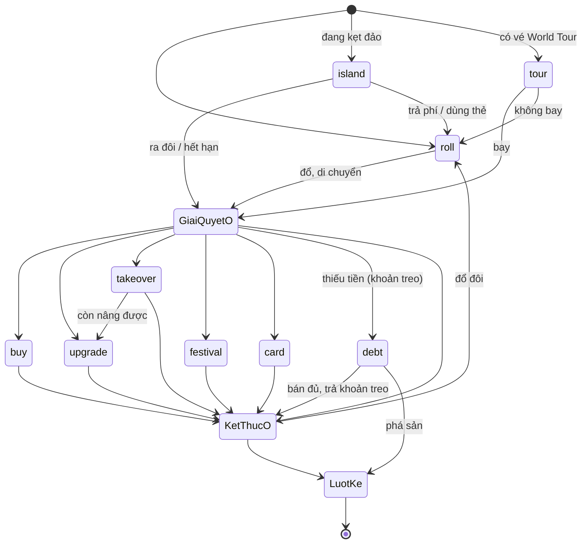

# Luật chơi Thái Thịnh Monopoly — v1.8.2

> Tự sinh từ `public/rules.js` bằng `npm run rules:doc`. Không sửa tay file này: sửa `rules.js`, chạy `npm run verify`.

Bộ luật có ba lớp: **thông số** (con số), **sơ đồ trạng thái** (luồng một lượt), **bảng quyết định** (kết quả từng tình huống). Engine đọc thông số và sơ đồ trạng thái từ cùng file; mỗi dòng bảng quyết định là một bài kiểm thử (`test/rules.test.js`).

## 1. Thông số

| Thông số | Giá trị |
|---|---|
| Tiền đầu ván | 2000K |
| Lương qua Start | 300K |
| Số người chơi | 2–4 |
| Đổ đôi liên tiếp vào đảo | lần thứ 3 |
| Lost Island | kẹt 3 lượt, phí rời đảo 200K |
| Lễ hội (Championships) | ×2 → ×3 → ×4 → ×5 → ×6 → ×7 → ×8 → ×9 → ×10 theo số lần tổ chức |
| Vé World Tour | 50K |
| Thuế | 10% tổng tài sản |
| Bảng giá công trình | Mỗi thành phố dùng bảng giá tuyệt đối theo 5 cấp trong bảng bên dưới |
| Tiền thuê theo cấp | Mỗi thành phố dùng bảng giá thuê tuyệt đối theo 5 cấp trong bảng bên dưới |
| Giới hạn xây | vòng đầu tối đa Nhà 2; đã qua Start: Nhà 3; Khách sạn khi quay lại ô đã có Nhà 3 |
| Mua lại | 2× giá trị cộng dồn; Khách sạn và bãi biển không bị mua lại; người mua nhận nguyên cấp nhà |
| Bán cho ngân hàng | 50% giá trị cộng dồn |
| Độc quyền nhóm màu | thuê ×2 |
| Bãi biển | giá 200K; thuê 25K / 50K / 100K / 200K theo số bãi cùng chủ |
| Cờ lễ hội | mỗi ván 3 ô ngẫu nhiên, thuê ×2 |
| Làm tròn tiền thuê | 0.5K |
| Thẻ Cúp điện | 3 vòng |
| Thời lượng ván | 60 phút / 90 phút / 120 phút; hết giờ → giàu nhất thắng |
| Thời gian mỗi bước | 20 / 30 / 45 / 60 giây (mặc định 30), cộng 6 giây cho hoạt ảnh; hết giờ → tự đi |
| Mất kết nối | người khác bấm "Đi hộ" sau 15 giây; server tự đi sau 60 giây |

### Bàn cờ

| Ô | Tên | Loại | Nhóm | Giá đất | Giá Ô đất → Khách sạn | Thuê Ô đất → Khách sạn |
|---|---|---|---|---|---|---|
| 0 | Start | start |  |  |  |  |
| 1 | Granada | city | Tây Ban Nha | 60K | 60K / 110K / 160K / 210K / 360K | 2K / 25K / 50K / 75K / 150K |
| 2 | Seville | city | Tây Ban Nha | 60K | 60K / 110K / 160K / 210K / 360K | 2K / 28K / 55K / 83K / 165K |
| 3 | Madrid | city | Tây Ban Nha | 60K | 60K / 110K / 160K / 210K / 360K | 4K / 30K / 60K / 90K / 180K |
| 4 | Bali | resort |  | 200K |  |  |
| 5 | Hong Kong | city | Trung Quốc | 100K | 100K / 150K / 200K / 250K / 400K | 6K / 33K / 65K / 98K / 195K |
| 6 | Beijing | city | Trung Quốc | 100K | 100K / 150K / 200K / 250K / 400K | 6K / 35K / 75K / 105K / 210K |
| 7 | Shanghai | city | Trung Quốc | 120K | 120K / 170K / 220K / 270K / 420K | 8K / 38K / 75K / 113K / 225K |
| 8 | Lost Island | island |  |  |  |  |
| 9 | Venice | city | Ý | 140K | 140K / 240K / 340K / 440K / 690K | 10K / 70K / 140K / 210K / 385K |
| 10 | Milan | city | Ý | 140K | 140K / 240K / 340K / 440K / 690K | 10K / 75K / 150K / 225K / 413K |
| 11 | Rome | city | Ý | 160K | 160K / 260K / 360K / 460K / 710K | 12K / 80K / 160K / 240K / 440K |
| 12 | Chance | chance |  |  |  |  |
| 13 | Hamburg | city | Đức | 180K | 180K / 280K / 380K / 480K / 730K | 14K / 85K / 170K / 255K / 468K |
| 14 | Cyprus | resort |  | 200K |  |  |
| 15 | Berlin | city | Đức | 200K | 200K / 300K / 400K / 500K / 750K | 16K / 90K / 180K / 270K / 495K |
| 16 | Championships | festival |  |  |  |  |
| 17 | London | city | Anh – Úc | 220K | 220K / 370K / 520K / 670K / 1045K | 18K / 113K / 225K / 338K / 619K |
| 18 | Dubai | resort |  | 200K |  |  |
| 19 | Sydney | city | Anh – Úc | 240K | 240K / 390K / 540K / 690K / 1065K | 20K / 120K / 240K / 360K / 660K |
| 20 | Chance | chance |  |  |  |  |
| 21 | Chicago | city | Mỹ | 260K | 260K / 410K / 560K / 710K / 1085K | 22K / 128K / 255K / 383K / 701K |
| 22 | Las Vegas | city | Mỹ | 260K | 260K / 410K / 560K / 710K / 1085K | 22K / 135K / 270K / 405K / 743K |
| 23 | New York | city | Mỹ | 280K | 280K / 430K / 580K / 730K / 1105K | 24K / 143K / 285K / 428K / 784K |
| 24 | World Tour | tour |  |  |  |  |
| 25 | Nice | resort |  | 200K |  |  |
| 26 | Lyon | city | Pháp | 300K | 300K / 500K / 700K / 900K / 1400K | 26K / 170K / 340K / 510K / 935K |
| 27 | Paris | city | Pháp | 320K | 320K / 520K / 720K / 920K / 1420K | 28K / 180K / 360K / 540K / 990K |
| 28 | Chance | chance |  |  |  |  |
| 29 | Osaka | city | Nhật Bản | 350K | 350K / 550K / 750K / 950K / 1450K | 35K / 190K / 380K / 570K / 1045K |
| 30 | Tax | tax |  |  |  |  |
| 31 | Tokyo | city | Nhật Bản | 400K | 400K / 600K / 800K / 1000K / 1500K | 50K / 200K / 400K / 600K / 1100K |

### Thẻ Chance

| Thẻ | Trọng số | Tác dụng |
|---|---|---|
| Cúp điện | 1 | Chọn 1 thành phố của đối thủ: mất điện 3 vòng, không thu được tiền thuê và mất lễ hội. |
| Động đất | 1 | Chọn 1 thành phố của đối thủ (đã có nhà, chưa lên Khách sạn) để hạ 1 cấp. |
| Đổi đất cưỡng chế | 1 | Đổi 1 thành phố của bạn lấy 1 thành phố của đối thủ (đều chưa lên Khách sạn). |
| Thẻ VIP | 1 | Giữ trong tay: tự động miễn 100% tiền thuê một lần. |
| Thoát đảo | 1 | Giữ trong tay: rời Lost Island ngay, không mất phí. |
| Tổ chức lễ hội | 1 | Đi ngay tới Championships để tổ chức lễ hội. |
| Vé máy bay | 1 | Đi ngay tới World Tour, lượt sau bay tới ô bất kỳ. |
| Trúng số độc đắc | 1 | Nhận ngay 200K từ ngân hàng. |

## 2. Sơ đồ trạng thái

| Bước | Khi nào | Hành động hợp lệ → kết quả |
|---|---|---|
| `roll` | Chờ đổ xúc xắc | **roll**: Đổ 2 xúc xắc, đi tổng số ô → giải quyết ô dừng. Đổ đôi: được đổ thêm sau khi xong ô (đôi lần 3 → Lost Island). |
| `island` | Đang kẹt ở Lost Island | **roll**: Ra đôi → thoát và đi luôn; không ra đôi → mất 1 lượt (hết 3 lượt thì tự rời đảo và đi). **payIsland**: Trả phí rời đảo → về bước roll. **useCard**: Dùng thẻ Thoát đảo → về bước roll. |
| `tour` | Lượt sau khi dừng ở World Tour | **tour**: Trả vé, bay tới thành phố chưa có chủ hoặc thành phố của mình. **skip**: Không bay → về bước roll. |
| `flight` | Vừa rút thẻ Vé máy bay | **flight**: Bấm OK trên thẻ → đi tới World Tour → giải quyết ô dừng. |
| `hostFestival` | Vừa rút thẻ Tổ chức lễ hội | **hostFestival**: Bấm OK trên thẻ → đi tới Championships → giải quyết ô dừng. |
| `buy` | Dừng ở ô chưa có chủ, đủ tiền mua đất | **buy**: Mua đất + xây tới cấp chọn (≤ giới hạn vòng) → kiểm tra thắng → kết thúc ô. **skip**: Không mua → kết thúc ô. |
| `upgrade` | Dừng ở ô của mình (hoặc vừa mua lại) còn nâng cấp được | **upgrade**: Nâng lên cấp chọn → kết thúc ô. **skip**: Để sau → kết thúc ô. |
| `takeover` | Vừa trả thuê ô người khác, đủ tiền mua lại | **takeover**: Trả 2× giá trị cho chủ, nhận nguyên cấp nhà → nếu còn nâng cấp được thì sang upgrade, không thì kết thúc ô. **skip**: Không mua → kết thúc ô. |
| `festival` | Dừng ở Championships | **festival**: Tăng hệ số ô đang tổ chức thêm 1; hoặc trả 50K để chuyển sang ô của mình. Hệ số tối đa ×10. **skip**: Bỏ qua → kết thúc ô. |
| `card` | Thẻ Chance cần chọn ô | **card**: Áp dụng thẻ lên ô chọn (Đổi đất: chọn 2 lần) → kết thúc ô. **skip**: Bỏ thẻ → kết thúc ô. |
| `debt` | Có khoản phải trả (thuê/thuế) lớn hơn tiền mặt; khoản này đang treo | **sell**: Bán 1 ô cho ngân hàng; đủ tiền thì trả khoản treo cho người nhận → kết thúc ô (đổ đôi thì đổ tiếp). **bankrupt**: Chỉ được phá sản khi bán hết vẫn không đủ: tự thanh lý toàn bộ đất, rồi chuyển toàn bộ tiền sau thanh lý cho người nhận → lượt người kế. |

- Phòng chờ: người vào đầu tiên là host; chỉ host được đổi cấu hình room, mời người chơi ra, bắt đầu hoặc reset ván. Host rời phòng thì quyền chuyển cho người vào kế tiếp.
- Bắt đầu lượt → tour (nếu đang có vé World Tour) / island (nếu đang kẹt đảo) / roll
- roll → di chuyển → GIẢI QUYẾT Ô (bảng quyết định) → buy | upgrade | takeover | festival | card | debt | KẾT THÚC Ô
- KẾT THÚC Ô → debt (còn khoản treo) | roll (đổ đôi) | lượt người kế
- Bất kỳ lúc nào: hết thời lượng ván → over (giàu nhất thắng); thắng ngay khi đủ điều kiện → over
- Hết thời gian một bước → tự làm hành động an toàn: roll / skip / bán ô rẻ nhất / bay không

## 3. Bảng quyết định

### Di chuyển

| Mã | Tình huống | Kết quả |
|---|---|---|
| M1 | Đổ 1+3 từ Start | Đi 4 ô tới Bali (chưa chủ) → bước buy |
| M2 | Đổ đôi 2+2, không mua | Được đổ thêm |
| M3 | Đã đôi 2 lần, đổ đôi lần 3 | Vào Lost Island 3 lượt, sang người kế |
| M4 | Đứng ô 30, đổ 1+2 | Qua Start: +300K, tính 1 vòng |

### Thành phố — chưa có chủ

| Mã | Tình huống | Kết quả |
|---|---|---|
| C1 | Đủ tiền mua đất | Bước buy |
| C2 | Không đủ tiền mua đất | Bỏ qua, sang người kế |
| C3 | Vòng đầu, chọn mua kèm Nhà 3 | Bị từ chối (vòng đầu tối đa Nhà 2) |
| C4 | Vòng đầu, mua kèm Nhà 2 | Trả giá Nhà 2 của Madrid: 160K |
| C5 | Đã qua Start, mua kèm Nhà 3 | Được phép, trả giá Nhà 3 của Madrid: 210K |

### Thành phố — của mình

| Mã | Tình huống | Kết quả |
|---|---|---|
| C6 | Ô của mình cấp 1, còn được xây | Bước upgrade |
| C7 | Ô của mình cấp 2, vòng đầu | Không nâng được nữa → kết thúc |
| C8 | Ô của mình Nhà 3 | Được xây Khách sạn |

### Thành phố — của người khác

| Mã | Tình huống | Kết quả |
|---|---|---|
| C9 | Đủ thuê, đủ mua lại | Trả thuê, chủ nhà hiện mặt vui → bước takeover |
| C10 | Mua lại ô cấp 1 | Trả 2× giá trị cho chủ, nhận nguyên Nhà 1 |
| C11 | Đủ thuê, không đủ mua lại | Trả thuê, thông báo "không đủ tiền mua tài sản này" |
| C12 | Khách sạn của người khác | Trả thuê, không được mua lại |
| C13 | Tiền thuê lớn hơn tiền mặt | Khoản thuê treo lại, chưa ai mất/nhận tiền → bước debt, thông báo "không đủ tiền thanh toán" |
| C14 | Đang nợ, bán 1 ô đủ tiền | Trả khoản treo cho chủ rồi mới sang người kế |
| C15 | Đổ đôi vào ô người khác, không đủ tiền | Phải bán trả xong mới được đổ tiếp |
| C16 | Đang nợ, phá sản ngay khi bán hết vẫn thiếu | Tự thanh lý đất rồi chuyển toàn bộ 80K cho chủ nợ |
| C16A | Đang nợ, bán tự động hết tài sản rồi phá sản | Chủ nợ vẫn nhận đúng tổng 80K như phá sản ngay |
| C16B | Tiền mặt cộng giá thanh lý vẫn đủ trả nợ | Không được tuyên bố phá sản; phải bán tài sản để trả |
| C17 | Chủ sở hữu cả nhóm màu | Thuê × 2 |
| C18 | Ô cắm cờ lễ hội đầu ván | Thuê × 2 |
| C19 | Ô đang tổ chức lễ hội lần 2 | Thuê × 3 |
| C20 | Ô đang mất điện | Không trả thuê |
| C21 | Có thẻ VIP, dừng ở ô đối thủ | Tự dùng 1 thẻ, miễn tiền thuê và hiện thông báo |
| C22 | Có thẻ VIP nhưng không đủ tiền mua lại | Ưu tiên thông báo đã dùng thẻ miễn thuê |
| C21 | Có thẻ VIP | Miễn thuê, mất 1 thẻ VIP |

### Bãi biển

| Mã | Tình huống | Kết quả |
|---|---|---|
| R1 | Bãi biển chưa chủ | Bước buy (chỉ mua đất) |
| R2 | Bãi của người có 2 bãi | Thuê 50, không được mua lại |

### Ô đặc biệt

| Mã | Tình huống | Kết quả |
|---|---|---|
| S1 | Dừng ở Lost Island | Kẹt 3 lượt |
| S2 | Đang kẹt, trả phí | Trả 200 → đổ bình thường |
| S3 | Đang kẹt, đổ không ra đôi | Mất lượt, còn 2 |
| S4 | Đang kẹt, dùng thẻ Thoát đảo | Rời đảo miễn phí và hiện thông báo |
| S5 | Dừng ở World Tour | Lượt sau được bay |
| S6 | Bay từ World Tour tới Madrid | Trả vé 50, qua Start +300, tính 1 vòng |
| S7 | Còn thành phố trống nhưng chọn ô của người khác | Bị từ chối |
| S8 | Dừng ở Tax, tổng tài sản 2000 | Nộp 10% = 200 |
| S9 | Dừng ở Championships, chuyển giải tới đất của mình | Trả 50K, hệ số lên ×2 |

### Thẻ Chance

| Mã | Tình huống | Kết quả |
|---|---|---|
| K1 | Rút Trúng số | +200 |
| K2 | Rút Thẻ VIP | Giữ 1 thẻ VIP |
| K3 | Rút Cúp điện, đối thủ có thành phố | Chọn ô của đối thủ |
| K4 | Rút Động đất | Hạ 1 cấp ô đối thủ |
| K5 | Rút Vé máy bay | Hiện thẻ, bấm OK rồi đi tới World Tour |
| K6 | Rút thẻ Tổ chức lễ hội | Dừng ở Chance, hiện thẻ và chờ bấm OK |
| K6A | Bấm OK thẻ Tổ chức lễ hội | Sau khi xác nhận mới đi tới Championships |

### Thắng

| Mã | Tình huống | Kết quả |
|---|---|---|
| W1 | Mua ô cuối cùng hoàn thành 3 nhóm màu | Thắng ngay |
| W2 | Hết thời lượng ván | Ván dừng, người có tổng tài sản lớn nhất thắng |
